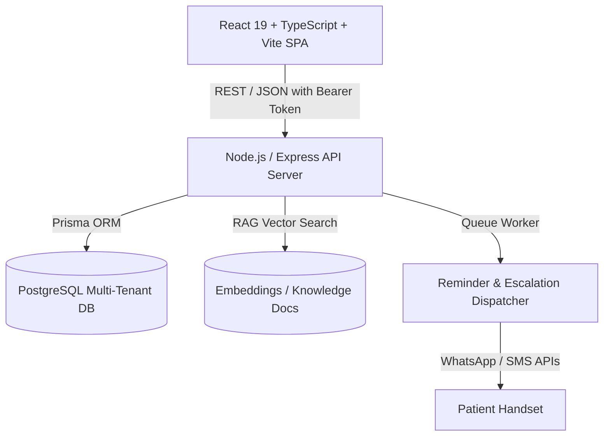

# 01 — Architecture Overview

## 1. System Vision
SmileCare AI is an enterprise-grade, multi-tenant dental practice SaaS that automates patient receptionist interactions, appointment booking, clinical emergency triage, and automated pre/post-operative patient care instructions via WhatsApp and SMS.

## 2. Multi-Tenant Isolation Model
1. **Strict Server-Enforced Tenancy**: The client request body or query string NEVER specifies `clinicId` as the tenant source of truth.
2. `clinicId` is injected into `req.clinicId` by server middleware (`authenticate` + `tenantScope`) strictly extracted from the cryptographically verified JWT bearer token.
3. Every Prisma query filters by `{ where: { clinicId } }`. Cross-tenant record lookups return standard `404 Not Found` responses to prevent tenant enumeration attacks.

## 3. Technology Stack
- **Frontend**:
  - React 19 (TypeScript, Tailwind CSS v4)
  - TanStack Query v5 with strict clinic-scoped cache keys (`[clinicId, resource, filters]`)
  - React Router v7 with resilient lazy loading (`lazyWithRetry`), ErrorBoundary, and Suspense
  - Recharts for high-fidelity clinical and throughput visual analytics
- **Backend**:
  - Node.js & Express / Fastify architecture
  - Prisma ORM 5 with PostgreSQL
  - Zod for request body and query param validation
  - Custom `ApiError` class with standardized error formatting `{ success: false, error: { code, message, details } }`
- **Background Jobs**:
  - Cron / Interval-driven scheduler for dispatching pre/post-op care reminders
  - Quiet hours constraint enforcement (skipping or delaying messages outside 08:00–21:00)
