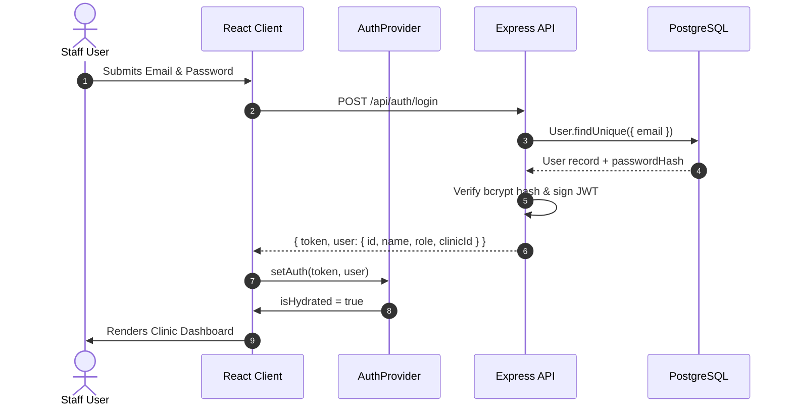

# 02 — Authentication & RBAC Flow

## 1. Authentication Lifecycle
- **Tokens**: JSON Web Tokens (JWT) signed with `JWT_SECRET`. Tokens embed `{ id, email, role, clinicId }`.
- **Hydration & Safety**:
  - The client auth context maintains an `isHydrated` state flag.
  - Route guards render a full-screen loading skeleton while reading from `localStorage`, ensuring zero flash of unauthenticated content.
  - Cross-tab synchronizations occur via window `storage` event listeners.

## 2. Role-Based Access Control (RBAC)
Supported roles within a dental practice tenant:

| Role | Permissions & Scope |
|---|---|
| `SUPER_ADMIN` | Global platform administration, tenant provisioning, system health metrics |
| `OWNER` / `CLINIC_OWNER` | Full clinic control: approve protocols, edit practice profile, manage billing, view all data |
| `ADMIN` | Staff user management, AI settings, appointments, patients, reports |
| `DENTIST` / `DOCTOR` | Clinical protocol approval, view assigned appointments & patients, schedule availability |
| `RECEPTIONIST` | Manage calendar, book/reschedule slots, patient directory, view triage alerts |

## 3. Server Enforcement & Zero Mock Policy
- **Elimination of Mock/Demo Users**: `DEMO_USER` has been completely deleted from `AuthProvider`.
- **Unauthenticated Redirection**: A fresh browser or incognito session starts with `user = null`. `RequireAuth` unconditionally redirects unauthenticated requests to `/login`.
- **Database Seeded Accounts** (Password: `Password123!`):
  - `krina@smilecare.ai` — Dr. Krina Khunt (`CLINIC_ADMIN` / Practice Owner)
  - `admin@smilecaredowntown.com` — Downtown Clinic Admin (`CLINIC_ADMIN`)
  - `doctor@smilecaredowntown.com` — Dr. John Smith (`DOCTOR` / Dentist)
  - `staff@smilecaredowntown.com` — Sarah Connor (`STAFF` / Receptionist)
  - `superadmin@smilecare.com` — Platform Administrator (`SUPER_ADMIN`)
- **Server Tenant Scoping**: Every protected route strictly derives `clinicId` from the authenticated JWT token (`req.clinicId`), preventing cross-tenant access. Unauthorized requests receive `401 Unauthorized` or `403 Forbidden`.
