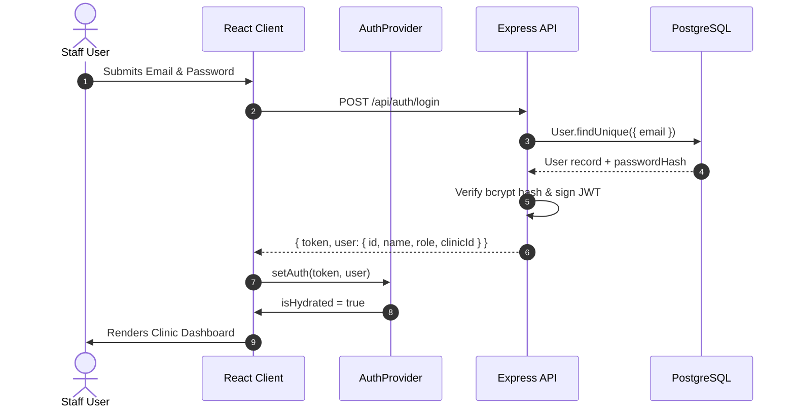

# 02 — Authentication & RBAC Flow

## 1. Authentication Lifecycle
- **Tokens**: JSON Web Tokens (JWT) signed with `JWT_SECRET`. Tokens embed `{ id, email, role, clinicId }`.
- **Hydration & Safety**:
  - The client auth context maintains an `isHydrated` state flag.
  - Route guards render a full-screen loading skeleton while reading from `localStorage`, ensuring zero flash of unauthenticated content.
  - Cross-tab synchronizations occur via window `storage` event listeners.

## 2. Role-Based Access Control (RBAC)
Supported roles within a dental practice tenant:

| Role | Permissions & Scope |
|---|---|
| `SUPER_ADMIN` | Global platform administration, tenant provisioning, system health metrics |
| `OWNER` / `CLINIC_OWNER` | Full clinic control: approve protocols, edit practice profile, manage billing, view all data |
| `ADMIN` | Staff user management, AI settings, appointments, patients, reports |
| `DENTIST` / `DOCTOR` | Clinical protocol approval, view assigned appointments & patients, schedule availability |
| `RECEPTIONIST` | Manage calendar, book/reschedule slots, patient directory, view triage alerts |

## 3. Server Enforcement
Every protected route enforces role access via `requireRole(['OWNER', 'DENTIST', ...])`. Even if the client-side UI hides a button, unauthorized requests sent directly to the API fail with `403 Forbidden`.
