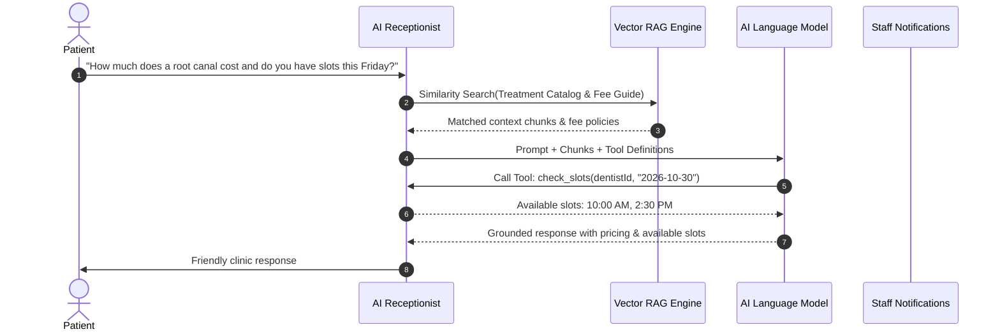

# 03 — AI Receptionist & RAG Flow

## 1. Overview
The AI Receptionist functions as an autonomous conversational front desk that answers patient inquiries 24/7 across website chat, WhatsApp, and phone intake.

## 2. Key AI Capabilities
- **Grounded Information Retrieval**: All fees, pre-op restrictions, and doctor schedules are grounded strictly in clinic documents stored in `KnowledgeBase`.
- **Hallucination Prevention**: If a policy or treatment is missing from the clinic's database, the model politely offers a staff callback instead of inventing numbers.
- **Tool Execution**: Tools include `list_services`, `check_availability`, `book_appointment`, and `escalate_to_staff`.
