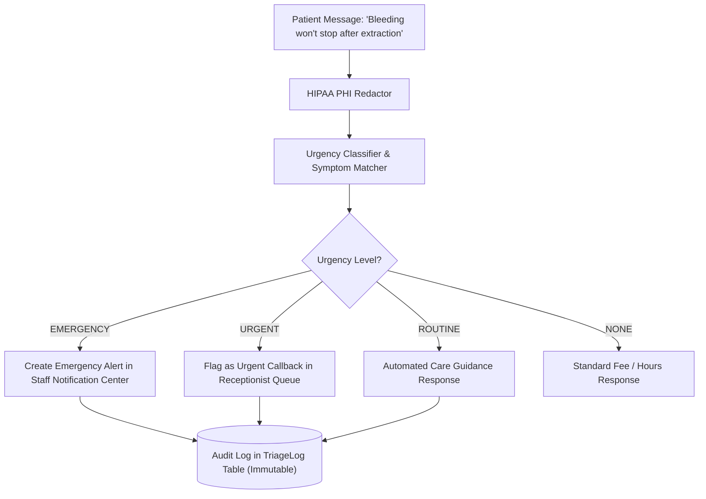

# 04 — Emergency Triage & Escalation Flow

## 1. Clinical Overview
Dental emergencies (e.g. uncontrolled bleeding, severe facial cellulitis swelling, trauma, acute throbbing pulpitis) require immediate clinical attention. The AI triage engine evaluates incoming patient statements in real-time, assigns urgency levels, and alerts staff.

## 2. Urgency Hierarchy
1. **EMERGENCY**: Uncontrolled hemorrhaging, airway compromise, severe facial asymmetry swelling, unmanageable 10/10 throbbing pain.
   - Action: High-visibility pulse banner in header dropdown, SMS alert to on-call dentist phone.
2. **URGENT**: Dislodged temporary crown, broken bracket with mucosal laceration, moderate localized swelling.
   - Action: Flagged in receptionist dashboard queue for same-day triage.
3. **ROUTINE**: Routine sensitivity after cleaning, questions about orthodontic aligners.
   - Action: Standard grounded care instructions delivered automatically.
4. **NONE**: Parking inquiries, fee schedule questions, insurance coverage.

## 3. HIPAA Redaction & Audit Logs
- Every triage interaction writes an immutable record to the `TriageLog` database table.
- Patient names, phone numbers, and direct addresses are masked via pattern redaction (`[REDACTED]`).
- Staff view the redacted audit logs on the **Triage Audit Logs** screen (`/app/triage-logs`) with status filter and timestamp tracking.
