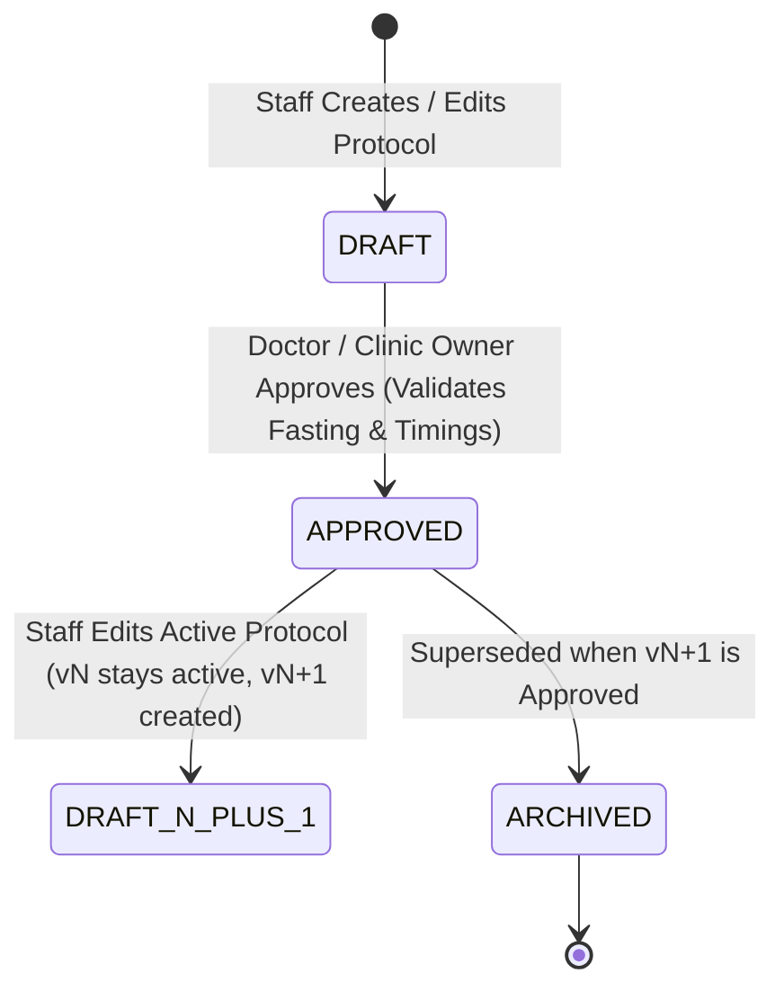

# 06 — Pre & Post-Op Care Protocols Flow

## 1. Clinical Protocol Architecture
Care Protocols ensure patients receive safe, timely medical instructions before and after invasive dental procedures (e.g. extractions, root canals, surgical implants, bone grafts).

## 2. Version Locking Policy
1. **Immutable Active Versions**: An approved protocol in active clinical use is never mutated in place.
2. **Draft vN+1 Creation**: When staff edits an approved protocol vN, the system creates a new draft version vN+1. Version vN remains active and continues dispatching patient reminders until version vN+1 is formally approved.
3. The UI provides a clear diff-style indicator: *"Editing creates version N+1; version N stays active until approved."*

## 3. Fasting / NPO and Timing Validation
- An unapproved draft protocol cannot be approved if it contains unresolved placeholder tokens such as `[NPO_HOURS]`, `[TIME]`, `[HOURS]`, `TODO`, or `TBD`.
- Protocols categorized as `FASTING` require explicit hourly fasting guidelines (e.g. *"Refrain from solid foods for 6 hours prior to IV sedation"*).
- Approval is strictly limited to authorized clinical roles (`DOCTOR`, `DENTIST`, `CLINIC_OWNER`, `OWNER`) and verified by server-side authorization checks.
