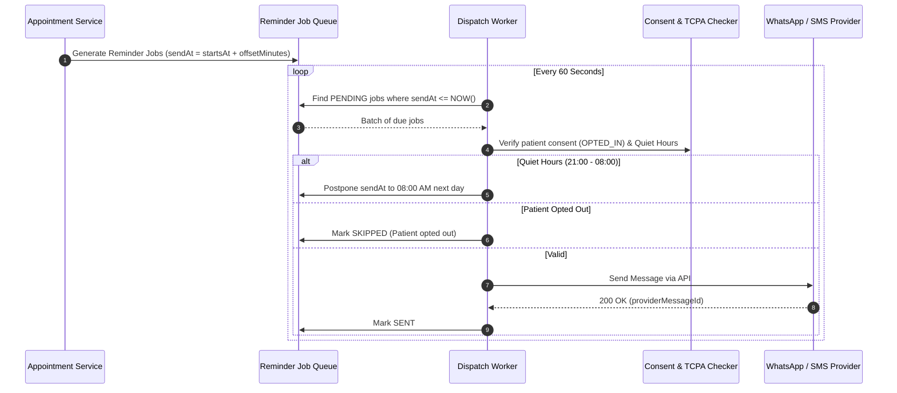

# 07 — Reminders, Campaigns & Quiet Hours Flow

## 1. Automated Dispatch Engine
When an appointment is confirmed, the scheduler computes scheduled send times for every instruction step in the active approved care protocol for that treatment.

## 2. Quiet Hours (TCPA Compliance)
- To prevent patient harassment and comply with telecommunication regulations, automated promotional campaigns and non-emergency reminder messages are paused during **Quiet Hours (21:00 – 08:00 in clinic timezone)**.
- If a message falls into quiet hours, its `sendAt` timestamp is shifted automatically to 08:00 AM the following morning.

## 3. Failed Reminders & Manual Retry
- If an SMS/WhatsApp gateway times out or returns an error, the job status moves to `FAILED` with `lastError` recorded.
- In both the **Appointment Drawer** and the **Reminders Overview Page** (`/app/reminders`), staff can view failure reasons and click **Retry Job** to re-queue the job with zero friction.
