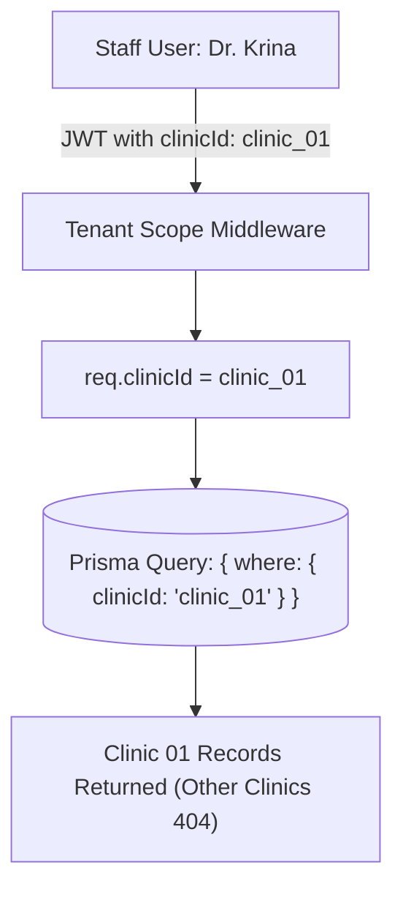

# 08 — Multi-Tenancy, Subscription & Billing Flow

## 1. Multi-Tenant Architecture
SmileCare AI isolates data at both the database and application levels:
- Every database model contains a `clinicId` foreign key.
- Compound unique indexes always prefix with `clinicId` (e.g. `@@unique([clinicId, dentistId, startsAt])`).
- Staff credentials and tokens are bound to a single clinic tenant.

## 2. Subscription Plans & Quotas
Tenants operate under tiered subscription tiers:

| Plan Tier | AI Chat Quota | Doctors Roster | WhatsApp Campaigns | Custom Branding |
|---|---|---|---|---|
| **Starter** | 250 chats / month | Up to 2 Dentists | Disabled | Standard |
| **Professional** | 1,000 chats / month | Up to 5 Dentists | Enabled | Custom Colors & Logo |
| **Enterprise** | Unlimited | Unlimited Dentists | Enabled + Priority Queue | White-Label Subdomain |

## 3. Usage Metering & Gating
- Layout headers and sidebars display active quota usage progress bars (`usagePercentage = (used / max) * 100`).
- If a tenant exceeds 80% quota, warning alerts trigger prompt notifications.
- Routes requiring advanced plan capabilities (e.g. `/app/campaigns`) are protected by `<RequireFeature featureKey="campaignsEnabled">` route wrappers.
